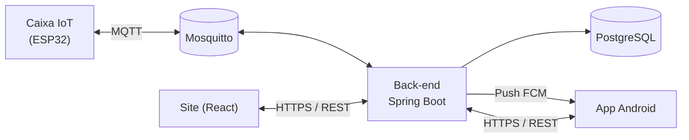

# Projeto-Cronomed

# CronoMed

**Sistema de gerenciamento de medicação** com caixa inteligente (IoT), aplicativo mobile e site.
Projeto da **FATEC Praia Grande – DSM4 (2º semestre de 2026)**.

O CronoMed ajuda pessoas a tomarem seus remédios no horário certo: uma caixa com 6 compartimentos acende o LED da cor do
remédio e toca um alarme na hora da dose; o aplicativo avisa o usuário e registra a confirmação; o site mostra o
histórico, o estoque e os relatórios. Familiares e cuidadores podem acompanhar o paciente, com consentimento (LGPD).

---

## Como o sistema funciona



- O **servidor** concentra as regras de negócio, o banco de dados e a segurança.
- A **caixa** recebe só números (horário, cor, identificador da dose), guarda na memória e dispara os alarmes sozinha,
  **mesmo sem internet**. Ao abrir uma tampa, envia o evento ao servidor.
- O **app** e o **site** consomem a mesma API REST. O app funciona offline e sincroniza depois.

---

## Estrutura do repositório

| Pasta | O que é | Tecnologias |
|---|---|---|
| [`cronomed-backend/`](cronomed-backend) | API REST, banco de dados e comunicação com a caixa (MQTT) | Java 21, Spring Boot 3.3, PostgreSQL, Flyway, JWT, MQTT, Docker |
| [`cronomed-web/`](cronomed-web) | Site para acompanhamento, cadastros e relatórios | React |
| [`cronomed-mobile/`](cronomed-mobile) | Aplicativo do usuário (alarmes, confirmação de dose, estoque) | Android (Kotlin) |
| [`cronomed-firmware/`](cronomed-firmware) | Código da caixa inteligente | C++ (Arduino IDE), ESP32 |
| [`.github/`](.github) | Automação (GitHub Actions) | CI |

Cada pasta tem o seu próprio `README.md` com instruções específicas.

---

## Status atual

| Módulo | Situação |
|---|---|
| **Back-end (API Java)** | Implementado. O fluxo principal foi validado rodando com PostgreSQL: cadastro, login, JWT, pacientes, caixa, medicamentos, geração de doses, confirmação com baixa de estoque (sem duplicidade) e renovação de token. |
| **Banco de dados** | PostgreSQL, com o esquema criado automaticamente (Flyway). O documento do projeto define um único banco relacional. |
| **Firmware (IoT)** | Código escrito e a lógica verificada em computador. **Ainda não testado na placa**, aguardando as peças. |
| **Site (web)** | Em desenvolvimento. |
| **App (mobile)** | Em desenvolvimento. |

Ainda não exercitados em testes reais: compartilhamento de acesso entre usuários, sincronização offline,
integração MQTT com a caixa física, notificações push (depende de credenciais do Firebase) e e-mail de recuperação de senha.

---

## Back-end: o que ele faz

- **Contas e segurança:** cadastro, login, recuperação de senha por código (OTP), tokens JWT com renovação, bloqueio após
  tentativas erradas, senhas com BCrypt, registro de auditoria que não pode ser alterado.
- **Pacientes e acesso:** o titular concede acesso (visualizar, confirmar, gerenciar) a familiares e cuidadores e pode
  revogar a qualquer momento.
- **Caixas IoT:** cadastro por MAC, 6 compartimentos com cor, padrão e identificação tátil (acessível para daltonismo e
  baixa visão), com limites por titular.
- **Medicamentos e doses:** horários por dia da semana, doses geradas para os próximos 7 dias, confirmação idempotente
  (reenviar o mesmo evento não baixa o estoque de novo).
- **Estoque e alertas:** baixa automática, reabastecimento, dias restantes e alertas de estoque baixo, bateria fraca
  e caixa offline.
- **Painel e relatórios:** resumo do paciente, histórico de doses e eventos, exportação em CSV.
- **Sincronização offline** para o app e **gateway MQTT** para a caixa.

Contratos completos de API e de mensagens da caixa: [`cronomed-backend/docs/API-E-MQTT.md`](cronomed-backend/docs/API-E-MQTT.md).

### Rodar o back-end

Pré-requisitos: **JDK 21**, **Docker Desktop** e (opcional) IntelliJ IDEA.

```bash
cd cronomed-backend
cp .env.example .env          # edite as senhas e gere um JWT_SECRET (mínimo 32 caracteres)
docker compose up -d postgres # sobe o banco
mvn -B verify                 # compila e roda os testes (ou use a aba Maven do IntelliJ)
```

Depois rode a classe `CronomedApplication` (perfil `dev`) e abra o Swagger em
`http://localhost:8080/swagger-ui.html`. Se a porta 5432 estiver ocupada no seu Windows, troque a porta do
host em `docker-compose.yml` (por exemplo, `5433:5432`) e ajuste `DB_URL`.

Para testar o fluxo completo de ponta a ponta, com a API rodando:

```powershell
powershell -ExecutionPolicy Bypass -File .\cronomed-backend\scripts\testar-fluxo.ps1
```

Guia completo de Docker, GitHub e organização: [`cronomed-backend/docs/GUIA-REPOSITORIOS-GITHUB-DOCKER.md`](cronomed-backend/docs/GUIA-REPOSITORIOS-GITHUB-DOCKER.md).

### Firmware da caixa

Veja [`cronomed-firmware/README.md`](cronomed-firmware/README.md): lista de componentes e ligações, bibliotecas do
Arduino IDE, cadastro da caixa no sistema e roteiro de teste de bancada.

---

## Como trabalhamos (Git)

- `main`: versão estável. **Protegida**, só recebe alterações por Pull Request revisado.
- `develop`: integração do dia a dia.
- `feature/<tarefa>`: uma branch por tarefa, criada a partir de `develop` (ex.: `feature/relatorio-csv`).
- `hotfix/<problema>`: correções urgentes a partir de `main`.

Fluxo: `feature/*` → Pull Request → `develop` → (fim da sprint) Pull Request → `main`.
Mensagens de commit: `feat:`, `fix:`, `docs:`, `test:`, `chore:`.

**Nunca** envie para o GitHub: arquivos `.env`, `secrets.h`, senhas, chaves ou credenciais do Firebase.

---

## Segurança e privacidade (LGPD)

- Senhas com hash BCrypt; comunicação por HTTPS/TLS em produção.
- Tokens de acesso curtos (15 min) e de renovação rotativos.
- Acesso de terceiros ao paciente só com consentimento do titular, revogável a qualquer momento e auditado.
- A caixa guarda apenas dados numéricos (sem nomes de remédios nem dados pessoais).

---

## Equipe

| Área | Responsável |
|---|---|
| Back-end – Java/API REST | (preencher) |
| Back-end – Banco de dados | (preencher) |
| Web | (preencher) |
| Mobile | (preencher) |
| IoT – protótipo, montagem e programação | (preencher) |

---

## Documentação

O documento completo do projeto (requisitos, arquitetura, casos de uso) acompanha a entrega da disciplina.